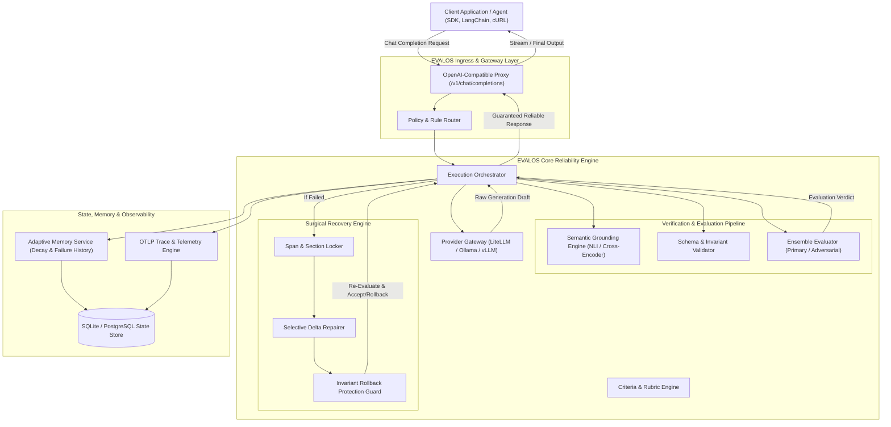
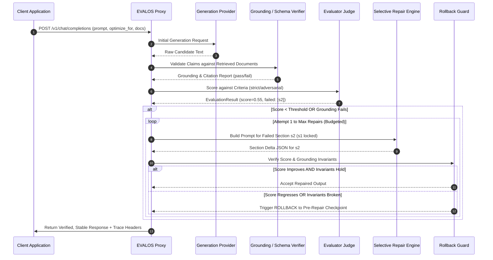
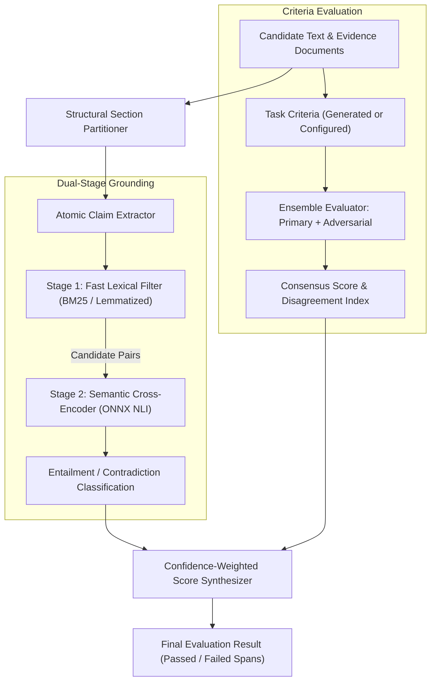
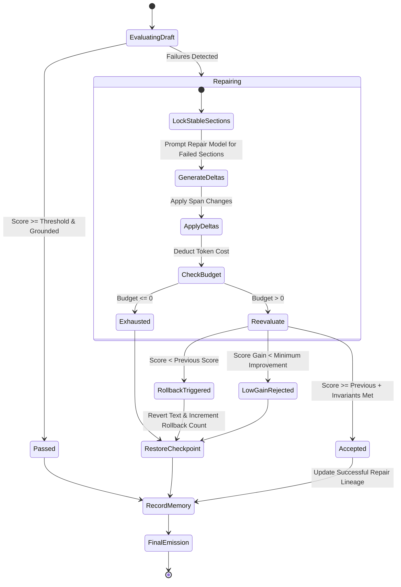
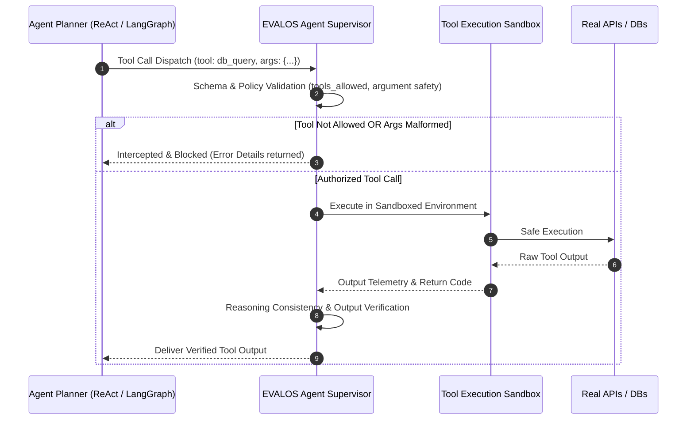
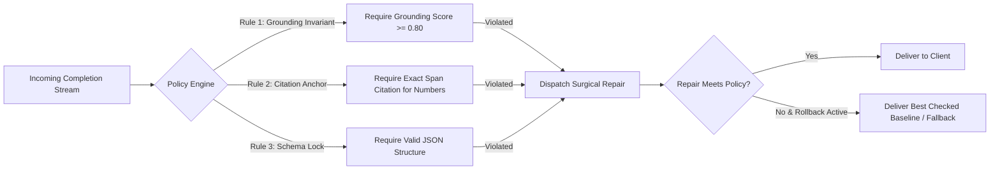

# EVALOS: Target System Architecture & Technical Specification

**Date:** November 2026  
**Auditor:** Principal AI Systems Architect & AI Infrastructure Engineer  

---

## 1. High-Level System Architecture

The redesigned EVALOS architecture transitions from a monolithic Python script into a clean, layered **Active Reliability Proxy and Middleware Runtime**:

---

## 2. Request Lifecycle Sequence

---

## 3. Evaluation Lifecycle Diagram

---

## 4. Repair & Rollback Lifecycle Diagram

---

## 5. Agent Execution Lifecycle (Target Future Supervisor)

---

## 6. Policy Enforcement Lifecycle Diagram

---

## 7. Component Boundaries & MVP vs. Future Scope

| Subsystem | Component | MVP Scope (v0.2) | Future Scope (v1.0+) |
| :--- | :--- | :--- | :--- |
| **Ingress** | Proxy Gateway | FastAPI `/v1/chat/completions` (sync + SSE streaming) | High-performance Go/Rust Reverse Proxy |
| **Core** | Pipeline Orchestrator | Decoupled event-driven Python pipeline | Multi-threaded async DAG engine |
| **Verification** | Grounding Engine | Dual-stage (BM25 + lightweight ONNX NLI) | Fine-tuned 8B Lynx model / Hosted API |
| **Verification** | Citation Validator | Fixed `ClaimSupport` attributes + exact span match | Automatic citation re-alignment & fuzzy search |
| **Repair** | Selective Repairer | Robust character-offset replacement + section locking | AST-level JSON & Markdown node replacement |
| **Safety** | Rollback Guard | Invariant-based regression check | Multi-checkpoint tree search (MCTS repair) |
| **Agent** | Agent Supervisor | Clean schema validation of agent traces | Live tool interception middleware (LangGraph/AutoGen) |
| **Memory** | Adaptive Memory | Normalized SQLite with indexed model/domain stats | Distributed Redis + Postgres with team clustering |
| **Telemetry** | Observability | OTLP OpenTelemetry exporter + ASCII console traces | Live streaming React dashboard + ClickHouse |

